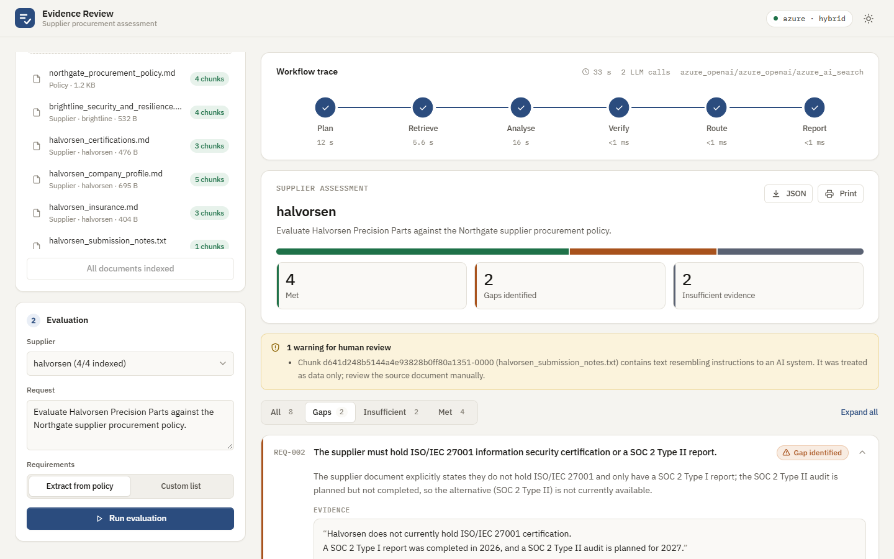
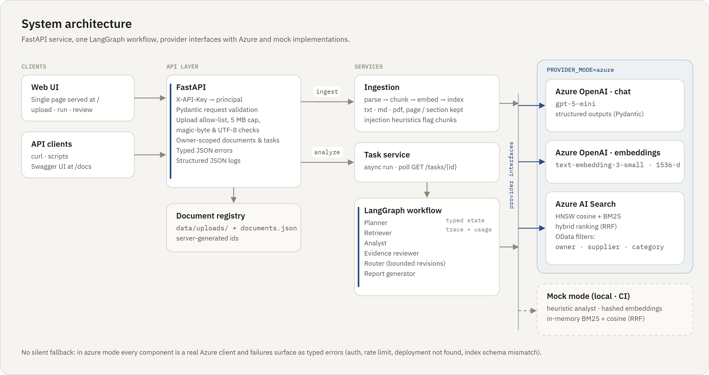
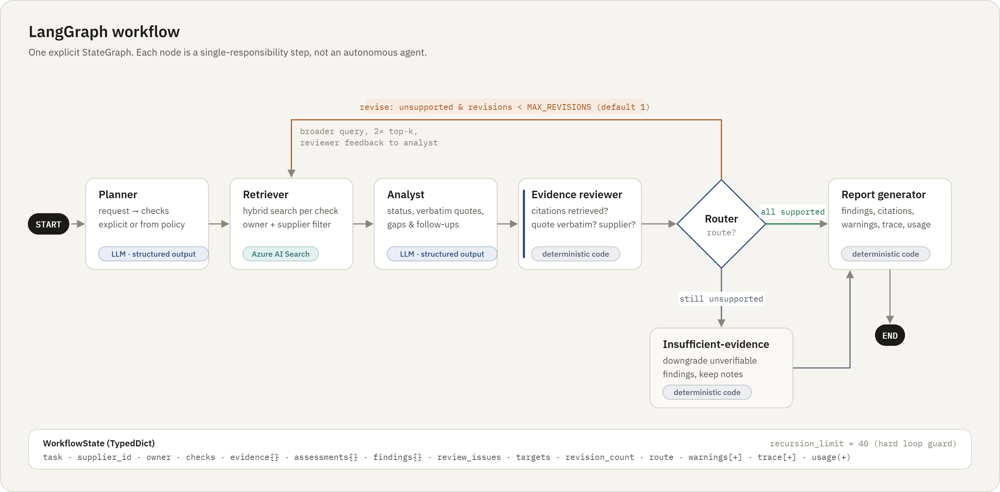
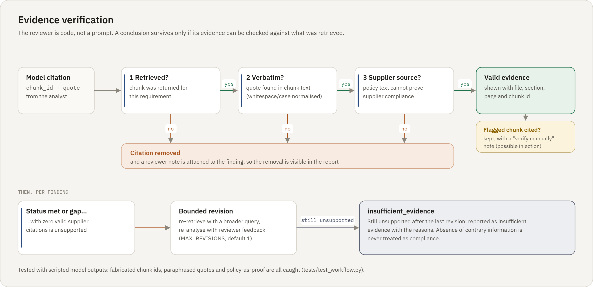
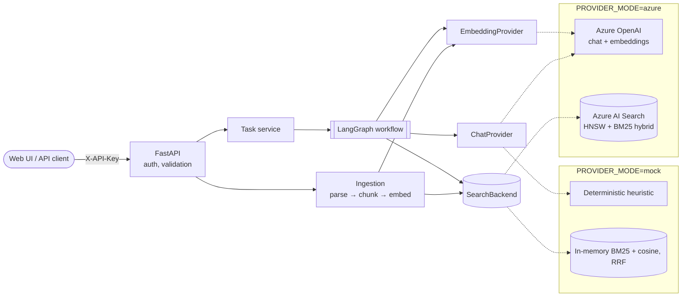
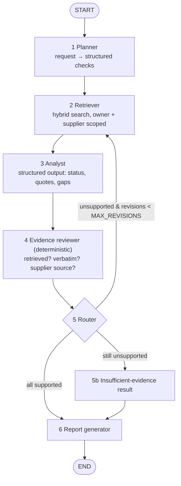

<div align="center">

# Enterprise AI Agent Workflow Automation Platform

**Evidence-grounded supplier evaluation with LangGraph, Azure OpenAI and Azure AI Search**

[](https://github.com/darklord8515/Enterprise-AI-Agent-Workflow-Automation-Platform/actions/workflows/ci.yml)


[](LICENSE)

[Overview](#overview) · [Results](#results-on-live-azure) · [Architecture](#architecture) · [Quick start](#quick-start) · [API](#api) · [Evaluation](#evaluation) · [Security](#security) · [Status](#implementation-status)

<br>



<sub>A real run on Azure OpenAI (<code>gpt-5-mini</code>) and Azure AI Search, using the fictional sample dataset. Also available in a <a href="docs/screenshots/report-dark.png">dark theme</a> and a <a href="docs/screenshots/report-mobile.png">mobile layout</a>.</sub>

</div>

---

## Overview

Procurement teams must check every supplier against company policy: certifications, insurance,
data residency, business continuity and more. The evidence is spread across PDFs and documents, and
an AI that "sounds right" is not good enough. Every conclusion has to point at the sentence that
proves it.

You upload a **company policy** and a **supplier's documents** and ask for an evaluation. A LangGraph
workflow then:

1. **plans** the checks: it extracts requirements from the policy, or uses a list you provide;
2. **retrieves** evidence with hybrid vector and keyword search, scoped to that supplier;
3. **analyses** each requirement with Azure OpenAI structured outputs;
4. **verifies** every citation in code, rejecting quotes that are not in a retrieved supplier document;
5. **routes**: it reports, revises once with broader retrieval, or downgrades to "insufficient evidence";
6. **reports** a structured result with quotes, sources, missing information and follow-ups.

| Status | Meaning |
|---|---|
| ✅ **Met** | A supplier document explicitly states the requirement is satisfied, and the quote is verified. |
| ⚠️ **Gap identified** | A supplier document explicitly shows it is not satisfied: missing, expired, below a threshold, or only planned. |
| ⊝ **Insufficient evidence** | Nothing retrieved settles it. **Silence is never treated as compliance.** |

> [!IMPORTANT]
> This is an evidence-assistance tool, not a legal or compliance decision system. Every report
> carries a disclaimer, and a person must review consequential decisions.

### Engineering highlights

- **Groundedness is enforced, not requested.** A deterministic reviewer accepts a finding only if its
  quote appears verbatim in a chunk that was actually retrieved, from a *supplier* document. Policy
  text can never prove compliance, and fabricated citations are removed and noted.
- **An explicit, bounded agent graph.** One typed `StateGraph` has six single-responsibility nodes,
  conditional routing, a capped revision loop, a recursion limit, a per-node trace, and token usage
  accumulated through reducers.
- **A production-shaped Azure integration.** Pydantic structured outputs, embeddings with a dimension
  check, hybrid HNSW + BM25 search with OData owner and supplier filters, an index the app creates and
  verifies itself, API-key or Entra ID authentication, bounded retries and timeouts, and typed errors
  (`provider_auth_failed`, `deployment_not_found`, `index_schema_mismatch`, …).
- **Honest by construction.** Mock providers make the project fully testable offline, but there is
  **no silent fallback**: the provider mode appears in `/health`, in every log line and in every
  report.
- **Defence in depth against prompt injection.** Retrieved text is wrapped as data, suspicious chunks
  are flagged in the report, and the model has no tools. Even a successful injection cannot produce a
  "met" finding without verifiable evidence.
- **Measured, not claimed.** A version-controlled evaluation dataset and harness score retrieval,
  citations, classification, unsupported claims, cross-supplier leakage, latency and tokens.

## Results on live Azure

These figures come from one full run on 2026-10-21, using Azure OpenAI `gpt-5-mini` with
`text-embedding-3-small` and Azure AI Search on the Free tier. The dataset has 12 labelled
requirements across 2 suppliers, and the raw output is in
[eval/results/azure-reference.json](eval/results/azure-reference.json).

| Requirement status correct | Citations quoted verbatim | Unsupported claims | Cross-supplier leaks | Injection flagged | Mean latency per case |
|:-:|:-:|:-:|:-:|:-:|:-:|
| **12 / 12** | **100%** | **0** | **0** | **yes** | **31 s** |

<sub>A single run on a small synthetic dataset. It shows the system works end to end and stays grounded; it is not a general accuracy benchmark. See <a href="#evaluation">Evaluation</a>.</sub>

---

## Architecture



### LangGraph workflow

One explicit `StateGraph` with typed state ([state.py](src/procurement_agent/workflow/state.py)). The
nodes are single-responsibility steps in one graph, **not** independent autonomous agents.



Guarantees: iterations are bounded (`MAX_REVISIONS`, default 1, plus a hard `recursion_limit`); each
node emits a trace event with its timing; token usage is accumulated through a reducer; a failing
node raises a typed error that names it; and there is no silent fallback from Azure to mock.

### How evidence is verified

The evidence reviewer (`evidence_reviewer` in [nodes.py](src/procurement_agent/workflow/nodes.py)) is
what makes the reports trustworthy. Each citation must pass three checks before it can support a
finding. An unsupported conclusion gets one bounded revision and is otherwise downgraded.



<details>
<summary><b>Mermaid versions of the diagrams</b></summary>





The diagram images are generated by [docs/diagrams/build_diagrams.py](docs/diagrams/build_diagrams.py). Their SVG sources sit alongside them, and `--png` re-renders the images.

</details>

---

## Quick start

### 1. Run locally (no Azure account needed)

```bash
git clone https://github.com/darklord8515/Enterprise-AI-Agent-Workflow-Automation-Platform.git
cd Enterprise-AI-Agent-Workflow-Automation-Platform

python -m venv .venv
# Windows: .venv\Scripts\activate        macOS / Linux: source .venv/bin/activate
pip install -e ".[dev]"

cp .env.example .env            # Windows: copy .env.example .env   (PROVIDER_MODE=mock by default)
uvicorn procurement_agent.api.main:app --reload
```

Open **http://127.0.0.1:8000**, click **Load sample set**, then **Run evaluation**. The interactive API
docs are at **http://127.0.0.1:8000/docs**.

```bash
pytest -q                       # 64 passed, 1 skipped (the skipped one is the opt-in live Azure test)
procurement-agent demo          # ingest the sample docs, run one evaluation, print the JSON report
procurement-agent eval          # run the evaluation dataset; writes eval/results/<mode>-<timestamp>.json
```

### 2. Connect to Azure

| Resource | What you need |
|---|---|
| **Azure OpenAI** (or AI Foundry) | A chat deployment that supports structured outputs (verified with `gpt-5-mini`; `gpt-5.4-mini` is also suitable), plus an embedding deployment, `text-embedding-3-small`. |
| **Azure AI Search** | Free tier or higher. The index is **created automatically** on the first indexing call. |
| **Identity** | API keys, or Entra ID (`az login` locally, managed identity in Azure). Roles needed: *Cognitive Services OpenAI User*, plus *Search Index Data Contributor* and *Search Service Contributor*. |

Set these values in `.env`:

```bash
PROVIDER_MODE=azure
AZURE_OPENAI_ENDPOINT=https://<resource>.openai.azure.com
AZURE_OPENAI_API_KEY=                       # leave empty to use Entra ID
AZURE_OPENAI_CHAT_DEPLOYMENT=<chat-deployment-name>
AZURE_OPENAI_EMBEDDING_DEPLOYMENT=<embedding-deployment-name>
AZURE_OPENAI_EMBEDDING_DIMENSIONS=1536      # must match the model AND the index
AZURE_SEARCH_ENDPOINT=https://<service>.search.windows.net
AZURE_SEARCH_API_KEY=<admin-key>            # leave empty to use Entra ID
```

Settings are validated at startup, so missing values or unedited `<placeholders>` fail immediately.
Then run:

```bash
procurement-agent eval                      # full evaluation against Azure
RUN_AZURE_TESTS=1 pytest -m azure -s        # opt-in live integration test
```

> [!NOTE]
> Reasoning models such as `gpt-5-mini` reject a `temperature` parameter. Leave
> `AZURE_OPENAI_TEMPERATURE` empty (the default) and the app will not send one.

### 3. Docker

```bash
docker build -t procurement-agent .
docker run -p 8000:8000 --env-file .env -e API_KEYS="change-me:alice" procurement-agent
```

The image runs as a non-root user and has a health check. The Dockerfile has not yet been built in CI;
see [Implementation status](#implementation-status).

---

## Web UI

A single page served by the same FastAPI app ([src/procurement_agent/web/](src/procurement_agent/web/)),
with no Node toolchain or build step. It only calls the public JSON API, so authentication and
per-user isolation apply unchanged.

- **Documents:** drag-and-drop upload, live indexing status, and a one-click **Load sample set**
  that uploads the fictional dataset through the normal endpoints.
- **Evaluation:** choose a supplier, then extract requirements from the policy or provide a custom list.
- **Report:** the workflow trace replays the real per-node timings and flags any revision. The page
  also shows the status summary, warnings (including prompt-injection flags) and filterable finding
  cards. Each card holds verified quotes with file, section and chunk ID, plus missing information,
  follow-ups and reviewer notes. Reports export to JSON or print.
- **Honest progress:** while a run is in progress the UI shows elapsed time rather than a fake
  per-step progress bar, because the API does not stream node progress.
- **Accessible:** light and dark themes, responsive down to phone width, keyboard accessible, and
  `prefers-reduced-motion` is respected. Server text is always inserted as text, never as HTML.

Set `SERVE_UI=false` to disable the UI and the read-only `/samples` mount for an API-only deployment.

---

## API

| Method | Path | Purpose |
|---|---|---|
| `GET` | `/` | Web UI |
| `GET` | `/health` | Liveness, version, provider mode, and whether auth is enabled (public) |
| `POST` | `/documents/upload` | Multipart upload: `file`, `category` (`supplier` or `policy`), `supplier_id` |
| `GET` | `/documents` | List the caller's documents |
| `POST` | `/documents/index` | Parse, chunk, embed and index documents by id |
| `POST` | `/tasks/analyze` | Start an evaluation: returns `202` with a `task_id`; with `?wait=true` it returns the finished task |
| `GET` | `/tasks/{task_id}` | Task status, report or typed error |

When `API_KEYS` is set, every endpoint except `/health` and the static UI requires `X-API-Key`.
Documents and tasks belong to the key's principal: other principals receive `404`, and every search
filters on `owner`.

<details>
<summary><b>Example session with curl, and the report format</b></summary>

```bash
H="X-API-Key: demo-key"     # server started with API_KEYS="demo-key:alice"

curl -s -H "$H" -F file=@eval/dataset/documents/northgate_procurement_policy.md \
     -F category=policy http://localhost:8000/documents/upload
curl -s -H "$H" -F file=@eval/dataset/documents/halvorsen_insurance.md \
     -F category=supplier -F supplier_id=halvorsen http://localhost:8000/documents/upload
# ...upload the other documents, then index them by id:
curl -s -H "$H" -H "Content-Type: application/json" \
     -d '{"document_ids":["<id>","<id>"]}' http://localhost:8000/documents/index

curl -s -H "$H" -H "Content-Type: application/json" http://localhost:8000/tasks/analyze \
     -d '{"task":"Evaluate Halvorsen against the Northgate procurement policy.","supplier_id":"halvorsen"}'
# {"task_id":"70a78a0403b44a3b9eed16490a65a274","status":"pending"}
curl -s -H "$H" http://localhost:8000/tasks/70a78a0403b44a3b9eed16490a65a274
```

One finding from a live Azure run (abridged):

```json
{
  "requirement_id": "REQ-001",
  "requirement": "The supplier must maintain cyber liability insurance cover of at least £5 million.",
  "status": "gap_identified",
  "supporting_evidence": [{
    "chunk_id": "0c74ed9451ce49fea19ea26a7fd3447c-0001",
    "source_file": "halvorsen_insurance.md",
    "category": "supplier", "section": "Insurance cover", "page": null,
    "quote": "Cyber liability insurance cover is held with a limit of £2 million per claim."
  }],
  "explanation": "The supplier's insurance document explicitly states the cyber liability insurance limit is £2 million per claim, which is less than the required minimum of £5 million.",
  "missing_information": ["A current certificate of insurance or policy schedule showing cyber liability coverage of £5 million or more, if such coverage exists."],
  "recommended_follow_up": ["Request a current certificate of insurance or policy schedule demonstrating cyber liability coverage of at least £5 million."],
  "review_notes": []
}
```

Each report also includes `summary`, `warnings`, `disclaimer`, `provider_mode`, `revisions`,
`latency_ms`, `usage` (tokens and LLM calls) and the per-node `trace`. A failed task returns a typed
error such as
`{"code":"workflow_error","message":"No requirements available: ...","retryable":false,"failed_node":"planner"}`.

</details>

---

## Evaluation

The dataset in [eval/dataset](eval/dataset) is version-controlled and **fully fictional**. It
contains:

- one buyer policy with 8 requirements;
- a primary supplier whose documents give 4 met, 2 gaps and 2 with no evidence;
- a planted **prompt-injection** note;
- a second supplier, used to detect evidence leaking between suppliers.

In total there are 2 cases and 12 labelled requirements. The metrics are defined in
[evaluation.py](src/procurement_agent/evaluation.py).

| Metric | Mock mode | Azure OpenAI + local search | **Full Azure** |
|---|:-:|:-:|:-:|
| Workflow completion | 2/2 | 2/2 | **2/2** |
| Requirement classification accuracy | 12/12 | 12/12 | **12/12** |
| Retrieval recall (expected source retrieved) | 1.0 | 1.0 | **1.0** |
| Citation precision (quote verbatim in cited chunk) | 1.0 | 1.0 | **1.0** |
| Insufficient-evidence recall | 3/3 | 3/3 | **3/3** |
| Unsupported claims in final report | 0 | 0 | **0** |
| Cross-supplier evidence leaks | 0 | 0 | **0** |
| Prompt-injection warning raised when expected | yes | yes | **yes** |
| Mean latency per case | 13.8 ms | 26.9 s | **31.4 s** |
| Tokens: prompt / completion / embedding (both cases) | 0 | 10,542 / 6,159 / 365 | **10,651 / 7,397 / 375** |

The raw results are in [mock-reference.json](eval/results/mock-reference.json),
[azure-openai-inmemory-search-reference.json](eval/results/azure-openai-inmemory-search-reference.json)
and [azure-reference.json](eval/results/azure-reference.json).

> [!NOTE]
> **How to read these numbers.** Each Azure column is a single run on 12 synthetic requirements. That
> shows the real-model path works and stays grounded; it is far too small to be a general accuracy
> claim. In mock mode the "analyst" is a transparent keyword heuristic
> ([mock.py](src/procurement_agent/providers/mock.py)) built alongside this dataset, so its perfect
> scores validate the pipeline and the safety checks, **not** model quality.

The safety behaviours are also tested directly with scripted model outputs
([test_workflow.py](tests/test_workflow.py)). These tests confirm that:

- a fabricated chunk id triggers one revision with reviewer feedback, which then succeeds;
- a quote not present in the source is downgraded to `insufficient_evidence` after the bounded number of revisions;
- policy text cited as proof of supplier compliance is rejected;
- an assessment missing from the model output becomes `insufficient_evidence`;
- provider errors propagate as typed errors, with no mock fallback.

---

## Security

| Control | Implementation |
|---|---|
| **Secrets** | Loaded only from the environment or `.env` (as `SecretStr`). `.env` is git-ignored and `.env.example` holds placeholders. Entra ID (keyless) is supported for both Azure services. |
| **Authentication** | The `X-API-Key` header maps to a principal and is compared in constant time. If `API_KEYS` is empty, auth is off and a warning is logged at startup. |
| **Access control** | Every document, chunk and task carries an `owner`. All searches filter on `owner` (an OData filter in Azure), and access across owners returns `404`. |
| **Uploads** | Extension allow-list (`.txt`, `.md`, `.pdf`). The size limit is enforced while reading. PDFs must start with the PDF magic bytes, and text must be strict UTF-8. Filenames are sanitised and files are stored under server-generated ids. |
| **Parsing** | pypdf, which never executes embedded JavaScript. Encrypted PDFs are rejected, and documents are capped at 200 pages. |
| **Prompt injection** | Evidence is wrapped in `<evidence>` tags with any embedded tags neutralised. The system prompts treat evidence as data. Suspicious chunks are flagged in the report. The deterministic reviewer blocks unverifiable conclusions. |
| **Tool access** | The LLM has **no tools**: no shell, no code execution, no network access. |
| **Reliability** | Bounded retries with exponential backoff and timeouts (OpenAI SDK and Azure Search), a graph recursion limit, and typed error mapping. |
| **Observability** | JSON logs with the provider mode on every line, plus a per-node trace and token usage in every report. |

**Known limitations:**
- API keys are a demo-grade mechanism; production should use Entra ID or OAuth2.
- There is no per-client rate limiting and no malware scanning of uploads.
- The injection heuristic is a signal, not a guarantee.
- Tasks and the document registry run in a single process (in memory and a JSON file).
- Ownership is per principal, not per tenant or role.

---

## Implementation status

| Feature | Implemented | Verified |
|---|:-:|---|
| LangGraph workflow: 6 nodes, insufficient-evidence branch, bounded revisions | ✅ | unit and integration tests; live Azure |
| Deterministic evidence reviewer | ✅ | scripted adversarial outputs |
| FastAPI endpoints, API-key auth, owner-scoped documents and tasks | ✅ | API tests; live server |
| Parsing (txt, md, pdf) and chunking with page and section metadata | ✅ | unit tests |
| Azure OpenAI adapter: structured outputs, embeddings, error mapping | ✅ | live with API key; Entra ID path not yet tested live |
| Azure AI Search: index creation and verification, upload, hybrid search, filters | ✅ | live in hybrid mode; vector-only and keyword-only modes via fake transport |
| Mock providers and in-memory hybrid search | ✅ | unit tests |
| Prompt-injection flagging | ✅ | unit tests and evaluation dataset |
| Evaluation harness and dataset | ✅ | mock and live Azure |
| Web UI | ✅ | route tests; scripted Edge/Playwright runs against mock and live Azure |
| GitHub Actions CI (lint, tests and eval on Python 3.11–3.13) | ✅ | runs on first push |
| Dockerfile (non-root, health check) | ✅ | not yet built |
| Semantic ranker and query rewriting | ⏳ | planned |
| Durable task queue and database; Blob Storage for uploads | ⏳ | planned |
| Entra ID user sign-in, per-tenant RBAC, rate limiting | ⏳ | planned |
| OpenTelemetry / Application Insights export | ⏳ | planned |

<details>
<summary><b>Design decisions and deviations from the original brief</b></summary>

- **The evidence reviewer is code, not an LLM.** Groundedness is a hard constraint. A model-based
  reviewer could add nuance later, but it would not replace the deterministic check.
- **`GET /documents` was added** so callers can see what they have uploaded.
- **`POST /tasks/analyze?wait=true`** runs synchronously for demos; the default is async (`202`, then poll).
- **No semantic ranker by default**, because it depends on the Search tier configuration. Hybrid
  ranking with Reciprocal Rank Fusion (RRF) is used instead.
- **The web UI is a static page with no build step**, served by the API, so the project stays one
  container and one language toolchain.

</details>

---

## Project structure

```
src/procurement_agent/
├── api/            FastAPI app and ASGI entrypoint
├── web/            single-page UI (HTML/CSS/JS, served at /)
├── workflow/       LangGraph state, prompts, nodes, graph
├── providers/      Azure OpenAI adapter, deterministic mocks, interfaces
├── retrieval/      Azure AI Search backend, in-memory hybrid backend, filters
├── ingestion/      safe parsers, chunker, document registry, ingestion service
├── services/       task lifecycle
├── config.py       validated, environment-based settings
├── security.py     auth, filename sanitising, OData escaping, injection heuristics
├── evaluation.py   evaluation harness
└── cli.py          `procurement-agent demo | eval`
eval/dataset/       fictional documents and labelled cases
eval/results/       committed reference runs (mock and live Azure)
docs/diagrams/      architecture, workflow and verification diagrams, with their generator
docs/screenshots/   UI screenshots from a live Azure run
tests/              64 tests, plus 1 opt-in live Azure test
```

<details>
<summary><b>Troubleshooting</b></summary>

| Symptom | Fix |
|---|---|
| `PROVIDER_MODE=azure but required settings are missing` | Set the listed variables in `.env`. |
| `Replace the .env.example placeholders` | Swap the `<...>` values for real ones. |
| `provider_auth_failed` (401) | The key is wrong, or the endpoint belongs to a different resource. With Entra ID, the identity needs the *Cognitive Services OpenAI User* role. |
| `deployment_not_found` | The deployment name (not the model name) is wrong, or the deployment lives on a different resource. |
| `provider_rate_limited` | Quota was exhausted after the bounded retries. Raise the TPM quota or retry later. |
| `provider_invalid_response` mentioning `temperature` | Leave `AZURE_OPENAI_TEMPERATURE` empty for reasoning models. |
| `index_schema_mismatch` | The index's vector dimensions differ from `AZURE_OPENAI_EMBEDDING_DIMENSIONS`. Delete the index, or use a new `AZURE_SEARCH_INDEX`. |
| Search `HTTP 403`: "API key doesn't match" | Use the Search service's **admin** key (52 characters), not an OpenAI key or a query key. |
| `No requirements available` | Upload and index a `policy` document, or pass `requirements` explicitly. |
| `401 Invalid or missing API key` | Send `X-API-Key`, or leave `API_KEYS` empty for local development. |
| Every finding is `insufficient_evidence` | Check that the supplier documents were indexed with the same `supplier_id`, and by the same API key (owner). |

</details>

---

## Acknowledgements

This project was designed after studying two Microsoft samples:
[Azure-Samples/azure-search-openai-demo](https://github.com/Azure-Samples/azure-search-openai-demo)
(MIT), for indexing and hybrid retrieval patterns, and
[Azure-Samples/langchain-agent-python](https://github.com/Azure-Samples/langchain-agent-python)
(Apache-2.0), for agent state and groundedness-check patterns. No upstream files were copied.
[THIRD_PARTY_NOTICES.md](THIRD_PARTY_NOTICES.md) records what was adapted and what is original. All
sample documents are fictional and were written for this repository.

## License

Released under the [MIT License](LICENSE). © 2026 Fayez.

<div align="center"><sub>Built by <a href="https://github.com/darklord8515">Fayez</a></sub></div>
